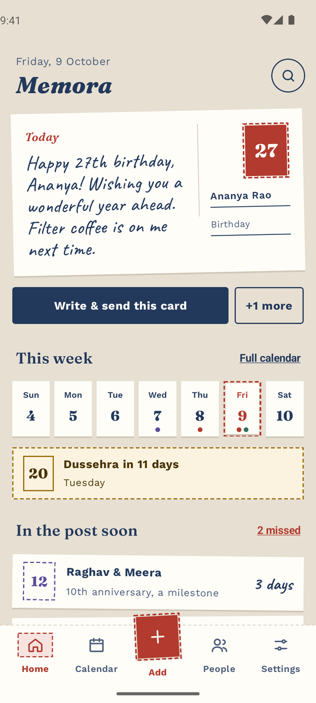
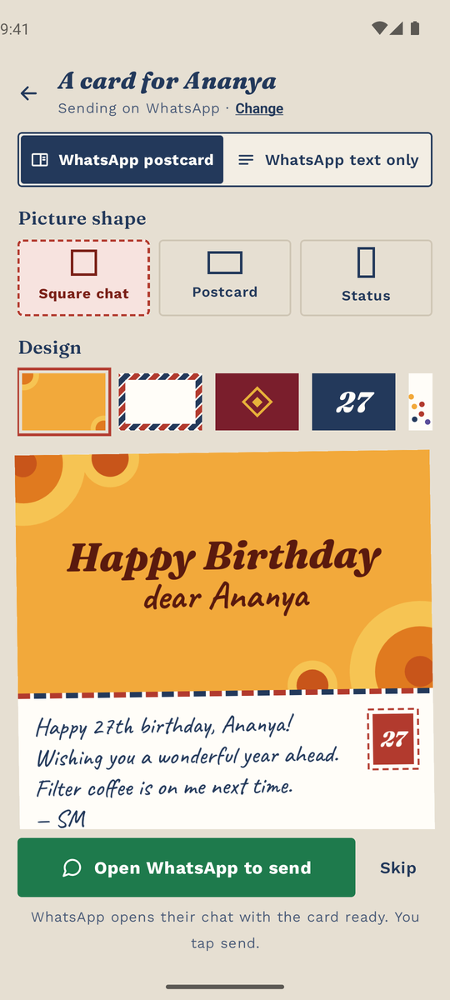
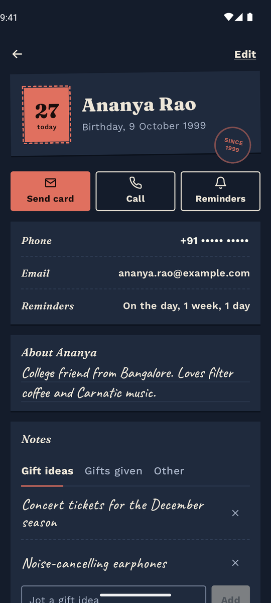

<p align="center">
  
</p>

<h1 align="center">Memora – Birthday & Anniversary Reminder App for Android</h1>

<p align="center">
  Never miss a birthday, anniversary or festival again. Memora reminds you on time and has a heartfelt wish ready to send on WhatsApp, SMS or email, as a message or a handmade-looking postcard.
</p>

<p align="center">
  <a href="https://github.com/smnexstudio/Memora/releases/latest"></a>
  <a href="LICENSE"></a>
  
  
</p>

## Screenshots

<p align="center">
  
  
  
</p>

Memora is a **free, open-source birthday reminder and anniversary reminder app for Android**. Add the people who matter, and Memora gives you an early reminder, a reminder on the day, and a ready-made wish you can send in two taps. It works **offline**, keeps **all your data on your phone**, and has **no ads, no account and no tracking**.

It's built with Indian families in mind too: festival reminders for Diwali, Ugadi, Sankranti, Eid, Christmas and more, and birthdays that follow the **Hindu lunar calendar (tithi)**.

## Download

<p align="center">
  <a href="https://github.com/smnexstudio/Memora/releases/latest"></a>
</p>

Open it on your phone and allow installing from your browser or file manager.

Needs **Android 13 or later**.

After that, Memora keeps itself up to date: it checks GitHub for a new release once a week (or when you tap **Settings → About Memora → Check for updates**), shows what's new, and installs it after Android asks you to confirm. Before installing, it checks the download matches the release's SHA-256 checksum and is signed with the same key as the Memora you have.

See what changed in each version in the [changelog](CHANGELOG.md). Each release lists a SHA-256 checksum, so you can check the file you downloaded is the one that was published.

## Features

### Birthday, anniversary and event reminders

- Birthdays, wedding anniversaries and any other occasion: housewarmings, graduations, farewells.
- An early reminder (1 week, 3 days, 2 days or 1 day before) and another on the morning of the day, at the time you choose.
- **Milestone alerts** two weeks before big ones: 18th, 21st, 25th, 50th birthdays; 10th, 25th, 50th anniversaries.
- Ages and "years married" worked out for you, even if you don't know the year for everyone.
- A Sunday digest of the week ahead, and a "missed" list so a belated wish is never forgotten.
- **Import birthdays and anniversaries from your phone contacts** in one go.

### Send wishes on WhatsApp, SMS or email

- Ready-made wishes in formal, fun and family tones, or write your own. `{name}`, `{age}` and `{ordinal}` fill in every year.
- **Digital postcards**: five designs (Marigold, Airmail, Rangoli, Big number, Confetti), shaped for a WhatsApp chat, a two-sided postcard or a **WhatsApp Status**.
- Or send plain text. Memora remembers how each person likes to be wished.
- Memora opens WhatsApp, Messages or your email app with everything filled in; you tap send.

### Festivals and the Hindu lunar calendar

- **Festival reminders** from Google's public holiday calendars: pick up to two, such as India and Hindu holidays, or the US, UK, UAE, Singapore, Christian or Islamic calendars (19 countries and 3 religious calendars).
- A reminder on the festival morning, and optionally one a week before.
- **Lunar birthdays and anniversaries**: an event can repeat on the same Hindu lunar date (for example "Bhadrapada Shukla Tritiya") instead of the same calendar date. Memora calculates the tithi on your phone, no internet needed.

### Remember the little things

- A note about each person, plus a log of **gift ideas** and **gifts given** each year, so you never give the same thing twice.
- A history of every wish you sent.
- A month calendar, a week strip, search across names, notes, phone and email, and a **home-screen widget** that shows what's coming up.

### Private by design

- **Everything stays on your phone.** No sign-up, no cloud, no ads, no analytics.
- Memora only goes online to download festival dates and to check GitHub for app updates.
- **App lock** with fingerprint, your phone's screen lock or a Memora PIN. While it's locked, Memora is hidden from screenshots and Recents, and names stay off the widget.
- **Encrypted backups**: save a backup file to Drive or your phone, protected with a password if you like (AES-256).

### Looks like a postcard

Paper cards, postage stamps and handwritten wishes, in light and dark themes.

## Privacy

Memora has no servers and no account. Your contacts, dates, notes and wishes live in the app's private storage on your phone. Contacts are read only when you import or look up a number, and nothing is uploaded. Festival dates are downloaded over HTTPS from Google Calendar's public holiday feeds, and update checks ask GitHub's public releases API for the latest version; no personal data is sent with either request. You can turn off automatic update checks in Settings.

## FAQ

**Is Memora free?**
Yes. It's free and open source under the GPL-3.0 licence, with no ads or in-app purchases.

**Does it send messages automatically?**
No. Memora prepares the wish and opens WhatsApp, SMS or email for you. You always tap send yourself.

**Do reminders work without internet?**
Yes. Reminders, wishes, lunar dates and the widget all work offline. Only festival dates (once a year) and update checks need a connection.

**Why are my reminders late?**
Some phones (Xiaomi, Oppo, Vivo, Realme, Samsung) pause dormant apps to save battery. If Memora's Settings shows "Reminders may arrive late", tap it and fix what's marked, usually by setting battery use to "Unrestricted". Because Memora doesn't run continuous background tasks, "Unrestricted" will not drain your battery.

**How do I move Memora to a new phone?**
Settings → Back up, save the file to Google Drive, then Restore on the new phone. Backups from Memora 1.x restore too.

**Is it on the Play Store?**
Not yet. Download it from [GitHub Releases](https://github.com/smnexstudio/Memora/releases/latest).

## Build from source

```bash
git clone https://github.com/smnexstudio/Memora.git
cd Memora
./gradlew assembleDebug        # Windows: gradlew.bat assembleDebug
```

You need JDK 17 and the Android SDK (platform 36). Setup, project layout, release signing and how each feature works are in **[docs/DEVELOPMENT.md](docs/DEVELOPMENT.md)**.

Built with Kotlin, Jetpack Compose, Material 3, SQLite and AlarmManager. No backend.

## Contributing

Bug reports, ideas and pull requests are welcome. Please open an [issue](https://github.com/smnexstudio/Memora/issues) first for larger changes.

## License

Memora is free software under the [GNU General Public License v3.0](LICENSE) (GPL-3.0-or-later): you can use, study, change and share it, and anything you publish built from it must also be GPL with its source available. The Memora name and stamp logo aren't covered by the licence, so a published fork needs its own name and icon.

Bundled fonts (OFL 1.1) and libraries (Apache 2.0) keep their own licences; see [NOTICE](NOTICE) and [licenses/](licenses/).

Memora is not affiliated with WhatsApp, Meta or Google.
